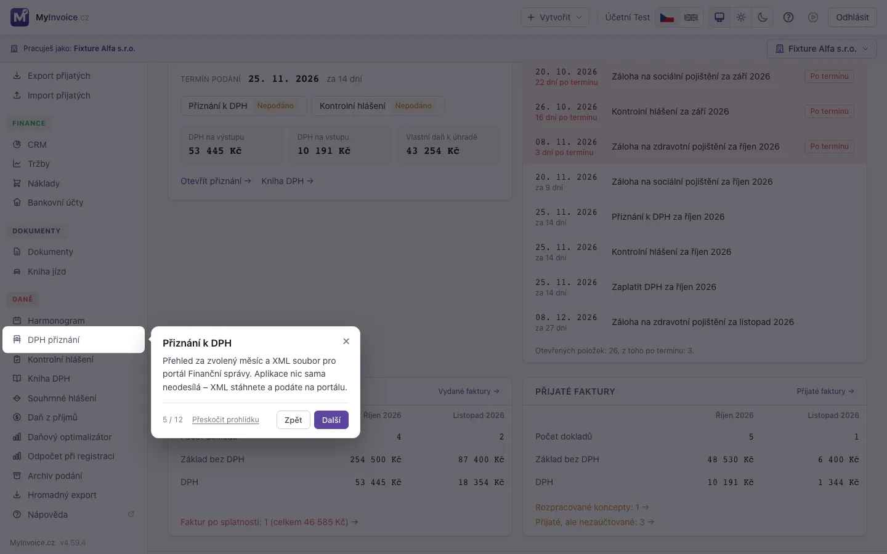
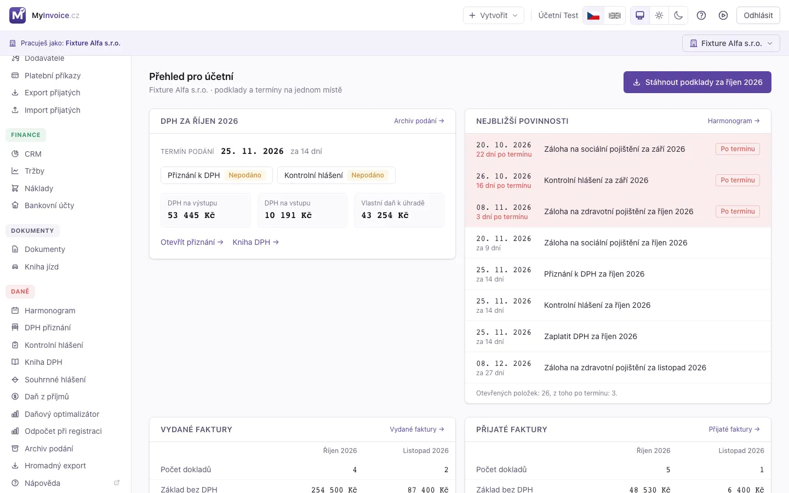

# 44. Prohlídka aplikace a přehled pro účetní

Dvě pomůcky pro člověka, který aplikaci vidí poprvé: **prohlídka aplikace**
(průvodce, který postupně ukáže, co kde je) a **přehled pro účetní** (úvodní
obrazovka, na které účetní najde to, co potřebuje, a ne obraty majitele firmy).

## 44.1 Prohlídka aplikace

Prohlídka ztmaví obrazovku, zvýrazní vždy jednu část aplikace a v bublince
stručně vysvětlí, k čemu slouží. V bublince je krátký název, text, počet kroků
(např. **5 / 12**) a tlačítka **Zpět**, **Další** a **Přeskočit prohlídku**.

- Spustí se **sama při prvním přihlášení** každého uživatele.
- Ovládáš ji tlačítky, šipkami na klávesnici (← →) nebo klávesou **Esc**, která
  prohlídku ukončí.
- Klik mimo bublinku prohlídku neukončí, ať ji omylem nezavřeš hned na začátku.
- Dokončení i přeskočení si aplikace pamatuje **u tvého účtu na serveru**, takže se
  prohlídka znovu nenabídne ani na jiném počítači nebo telefonu.
- **Znovu ji spustíš kdykoli** ikonou ▶ **Prohlídka aplikace** vedle nápovědy
  v horní liště. Na telefonu je stejná ikona dole v menu.
- Na úzké obrazovce (telefon, malé okno) se menu po straně otevírá a zavírá samo,
  podle toho, co právě ukazuje.
- Pokud se relace během prohlídky zamkne, prohlídka se přeruší a při dalším
  přihlášení se nabídne znovu.

### Co prohlídka ukazuje

Obsah se řídí rolí uživatele. Část aplikace, ke které role nemá přístup, se
v prohlídce vynechá.

| Role | Prohlídka |
|---|---|
| **Účetní** | Podrobná: přehled, Harmonogram, vydané a přijaté faktury, přiznání k DPH, kontrolní a souhrnné hlášení, archiv podání, hromadný export (měsíční ZIP s PDF a ISDOC pro program EKONOM), datové schránky (jen když jí je administrátor zpřístupnil), banka, účet uživatele (heslo, zabezpečení) a nápověda. |
| **Administrátor** | Kratší přehled: přehled, vydané a přijaté faktury, banka, daně a výkazy, Harmonogram, nastavení, účet uživatele a nápověda. |
| **Jen pro čtení** | Totéž bez částí, které nevidí (Harmonogram, Nastavení). |

> 💡 **Datové schránky** vidí účetní jen tehdy, když jí je administrátor zpřístupnil
> (u schránky volba *Zobrazit účetní*). Bez toho v menu položka není a prohlídka
> o datových schránkách nemluví. Viz
> [Zpřístupnění schránky účetní](42_Datove_schranky.md#zpristupneni-schranky-ucetni).

## 44.2 Přehled pro účetní

Uživatel s rolí **účetní** vidí na úvodní obrazovce místo obratů a grafů vlastní
přehled s tím, co při práci potřebuje. **Přehled administrátora se nemění.**

Tlačítko **Stáhnout podklady za …** vpravo nahoře otevře
[Hromadný export](34_Hromadny_export.md) rovnou nastavený na **poslední uzavřený
měsíc**, takže stačí spustit stažení.

### DPH za poslední uzavřený měsíc

Karta ukazuje poslední uzavřené období DPH — předchozí měsíc, u čtvrtletního plátce
poslední skončené čtvrtletí:

- **Termín podání** (25. den následujícího měsíce, při víkendu nebo svátku nejbližší
  pracovní den) a kolik dní zbývá nebo uplynulo. Když je vše podáno, termín se
  nezvýrazňuje.
- **Stav podání** přiznání k DPH, kontrolního hlášení a případně souhrnného hlášení
  podle [Archivu podání](29_Vykazy_DPH.md): *Nepodáno*, *Podáno*, *Potvrzeno*. Klik
  otevře příslušný výkaz za dané období.
- **DPH na výstupu**, **DPH na vstupu** a **vlastní daň k úhradě** (nebo
  **nadměrný odpočet**) tak, jak je počítá přiznání k DPH.
- Odkazy **Otevřít přiznání**, **Kniha DPH** a **Archiv podání**.

Pokud firma v daném období ještě není plátcem DPH, karta to řekne a uvede, od kdy
plátcem bude. Čísla se objeví po prvním uzavřeném období plátcovství.

### Nejbližší povinnosti

Až osm nejbližších nesplněných položek z [Harmonogramu](43_Harmonogram.md). Ty, které
už měly být hotové, jsou zvýrazněné červeně a řazené první. Pod seznamem je počet
všech otevřených položek a odkaz na celý Harmonogram, kde je můžeš odškrtávat.

### Vydané a přijaté faktury

Dvě karty s údaji za **minulý a tento měsíc** v korunách: počet dokladů, základ bez
DPH a DPH.

- U **vydaných** faktur se počítají vystavené, odeslané a zaplacené faktury,
  dobropisy a daňové doklady podle data zdanitelného plnění (koncepty a storna ne).
  Pod tabulkou je počet a součet faktur **po splatnosti** s odkazem na jejich seznam.
- U **přijatých** faktur se počítají zaúčtované a přijaté doklady podle data
  vystavení (koncepty a storna ne). Pod tabulkou jsou odkazy na **rozpracované
  koncepty** a na **přijaté, ale nezaúčtované** doklady, které čekají na zpracování.

Za měsíce bez dokladů se místo nul zobrazí věta, že nejsou žádné doklady.

### Datová schránka

Karta **Datová schránka** se zobrazí jen tehdy, když ti administrátor zpřístupnil aspoň
jednu [datovou schránku](42_Datove_schranky.md#zpristupneni-schranky-ucetni). Bez toho
na přehledu není vůbec. Ukazuje:

- **počet nevyřízených zpráv** — přijatých zpráv, které administrátor ještě neoznačil jako
  vyřízené (karta počítá jen zpřístupněné a zapnuté schránky),
- **tři nejnovější přijaté zprávy**: datum, odesílatele a věc. Nevyřízené mají vlevo
  tečku, zprávy od finančního úřadu štítek *Od finančního úřadu*.

Klik na zprávu ji otevře **jen ke čtení** na stránce Datové schránky, odkaz
**Otevřít datovou schránku** otevře celý seznam.
